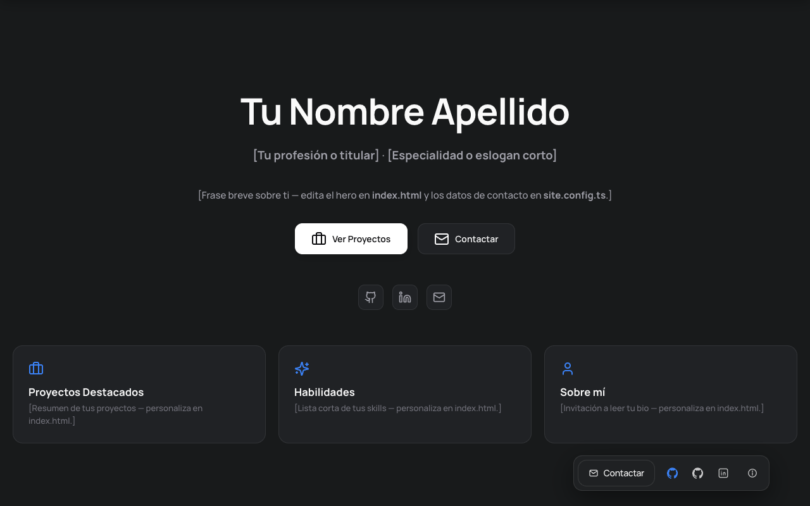
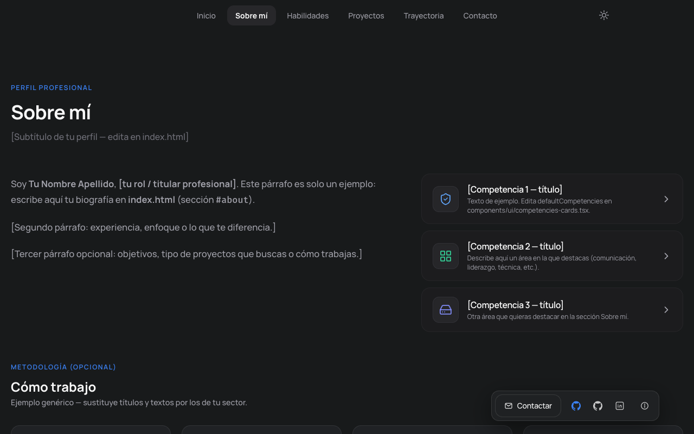
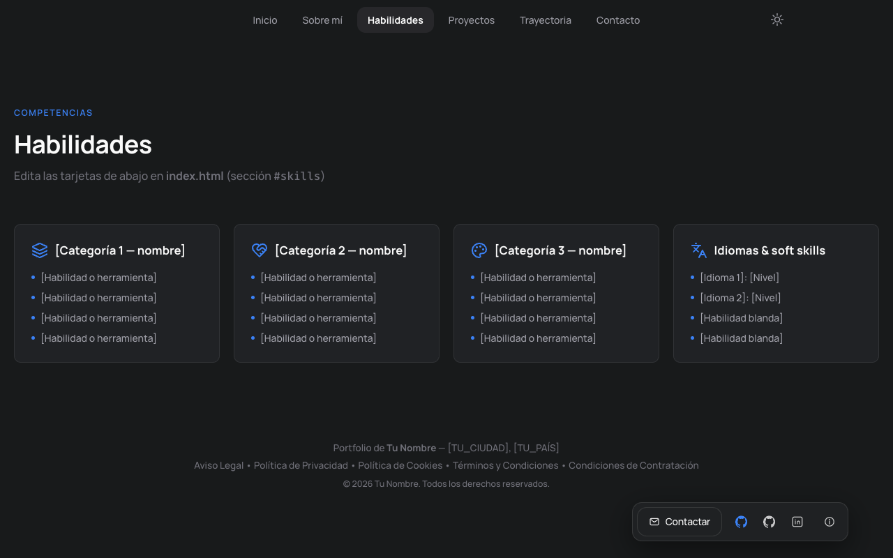
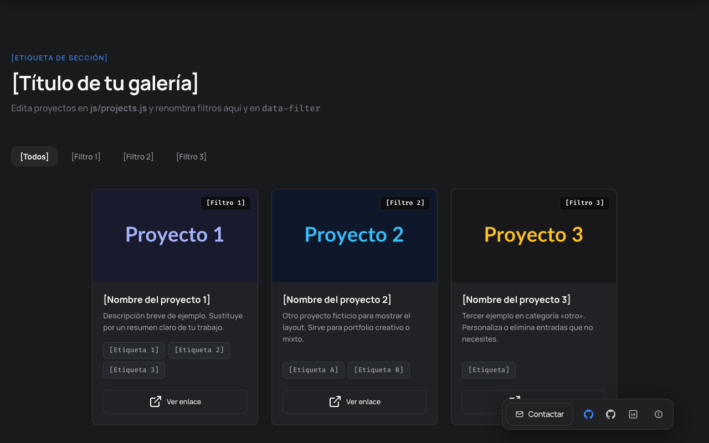
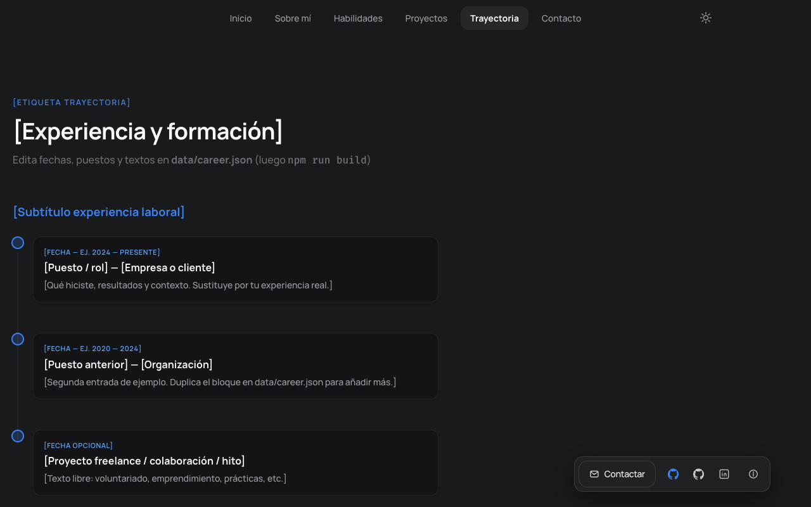
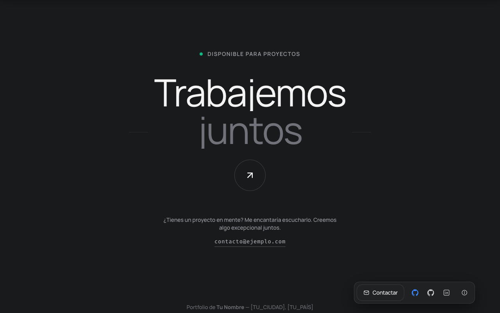

# Portfolio template

## Instalación

**Requisitos:** Node.js 20+ y npm 9+

```bash
git clone https://github.com/PablooFf-tech/portfolio-template.git mi-portfolio
cd mi-portfolio
cp site.config.example.ts site.config.ts
npm install
npm run dev
```

Abre la URL de Vite (por defecto `http://localhost:5173`).

Edita `site.config.ts` con tu nombre, email, GitHub y LinkedIn.

### Build

```bash
npm run build
npm run preview
```

---

## Capturas

### Inicio



### Sobre mí



### Habilidades



### Proyectos



### Trayectoria



### Contacto


